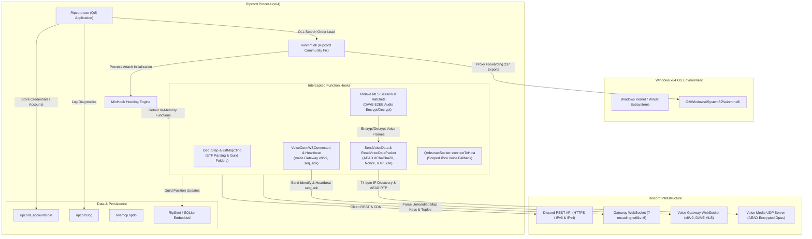

# Ripcord Technical Architecture & Component Map

## Overview

Ripcord is architected as an event-driven desktop chat client combining a native Qt5 GUI with background network worker threads, SQLite caching databases, and native audio codec pipelines.

Because the core executable `Ripcord.exe` is proprietary and closed-source, compatibility repairs and protocol extensions operate via two distinct architectural pathways:
1. **Dynamic Runtime Hooking (`winmm.dll`)**: A proxy DLL loaded automatically via Windows DLL search order hijacking, utilizing Microsoft Detours / MinHook to intercept internal functions and patch memory.
2. **Static PE Binary Patching (`patcher.exe`)**: An offline PE file modifier that alters specific instruction bytes directly within `Ripcord.exe` before execution.

---

## 1. System Architecture Diagram

---

## 2. Component Breakdown

### 2.1 User Interface & Event Processing
- **Framework**: Qt 5.12.1 (shared libraries: `Qt5Widgets.dll`, `Qt5Gui.dll`, `Qt5Core.dll`, `Qt5Svg.dll`).
- **Platform Plugin**: `platforms/qwindows.dll`.
- **UI Architecture**: Standard Win32/Qt message loop on the primary thread. Custom widget painting with dark mode styling engine, tabbed server views, custom channel lists, message log viewer, and inline attachment viewers.
- **Emoji Rendering**: Embedded Twemoji SQLite database (`twemoji.ripdb`, 4,368 table entries loaded at startup).

### 2.2 Network & Protocol Processing
- **REST & HTTP**: Managed via `Qt5Network.dll` (`QNetworkAccessManager`, `QNetworkReply`). Performs avatar downloads, message fetching, attachment uploads, and account authentication.
- **Gateway WebSockets**: Managed via `Qt5WebSockets.dll` (`QWebSocket`). Communicates over secure TLS (`wss://gateway.discord.gg`).
- **Gateway Payload Serialization**: Erlang External Term Format (ETF). Decoded by internal recursive descent parser (`Ded::Step` at RVA `0xB5EF0` and `ErfMap::find` at RVA `0xB9690`).
- **Voice WebSockets**: Dedicated worker thread per voice channel (`DisVLWorker`). Communicates with Discord voice servers (`wss://*.discord.media`).
- **Voice UDP Media Transport**: `QUdpSocket` transmitting RTP audio packets over UDP.

### 2.3 Authentication & Credential Storage
- **Local Storage File**: `%LOCALAPPDATA%\Ripcord\ripcord_accounts.bin`.
- **Format**: Proprietary serialized binary containing account credentials, tokens, and preferences.
- **Security Rule**: Session tokens and authentication secrets are held in memory and never written to standard diagnostic logs (`ripcord.log`).

### 2.4 Voice Signaling, Encryption & Codecs
- **Signaling**: Discord Voice Gateway v8 / v9 protocol.
- **Audio Codec**: Opus (dynamic library `opus.dll`). 48 kHz sampling rate, 20 ms frames (960 samples per frame).
- **Sample Rate Conversion**: `r8brain-free-src` (Voxengo).
- **Transport Encryption**:
  - Legacy (deprecated by Discord): `xsalsa20_poly1305`.
  - Modern (intercepted and enforced by `winmm.dll`): `aead_xchacha20_poly1305_rtpsize` via `libsodium.dll`.
- **End-to-End Encryption (E2EE)**: Discord DAVE protocol via `libdave.lib` (C++ MLS implementation). Encrypts outbound Opus frames before transport AEAD wrapping; decrypts inbound frames.

---

## 3. Runtime Hooking Map (`winmm.dll`)

| Target Address / RVA | Target Function | Hook Type | Purpose |
| :--- | :--- | :--- | :--- |
| `0xDE8D8` - `0xDE936` | Voice Worker Discovery | Byte Patches | Updates IP discovery packet buffer sizes (70 → 74 bytes). |
| `0x3CDEB4 + 0x1200` | Voice Gateway URL | Byte Patch | Sets Voice Gateway version to `8`. |
| `0x3E63F8` | Image Preview Template | String Patch | Replaces broken CDN URL with `cdn.discordapp.com/`. |
| `0xB9BBF` | `ErfMap` Key Check | Byte Patch | Discards unknown map keys instead of aborting connection. |
| `0xD677E` | Gateway Port Split | Byte Patch | Disables incorrect URL colon splitting. |
| `0xB9690` | `ErfMap::find` | MinHook Detour | Translates Stage channels to voice; resolves `guild_folders`. |
| `0xF9750` | `UpdateUserGuildPositions` | MinHook Detour | Updates user guild positions in SQLite database. |
| `0xCAFB0` | `SetVoiceEncStrings` | MinHook Detour | Replaces `xsalsa20_poly1305` with `aead_xchacha20_poly1305_rtpsize`. |
| `0xDD850` | `ReadVoiceDataPacket` | MinHook Detour | Decrypts AEAD packets, handles RTP extensions, decrypts DAVE. |
| `0xE2750` | `SendVoiceDatagram` | MinHook Detour | Encrypts audio with DAVE MLS and AEAD XChaCha20. |
| `0xC9190` | `DisVLWorker::DisVLWorker` | MinHook Detour | Allocates 2048-byte send buffer, hooks binary WebSocket slot. |
| `0xE6E80` | `VoiceConnWSConnected` | MinHook Detour | Sends Voice Identify with `max_dave_protocol_version: 1`. |
| `0xE5D60` | `VoiceConnTextMsgReceived` | MinHook Detour | Handles Voice Ready, Session Description, and Transitions. |
| `0xD5820` | `HeartbeatLambdaImpl` | MinHook Detour | Appends required `seq_ack` and timestamp `t` to Op 3. |
| `0xB5EF0` | `Ded::Step` | MinHook Detour | Parses Erlang `SMALL_TUPLE_EXT` (tag 104) without errors. |
| `Qt5Network` | `connectToHost` | MinHook Detour | Scoped fallback to IPv4 for `*.discord.media` voice servers. |
| `Qt5Network` | `writeDatagram` | MinHook Detour | Upgrades IP discovery UDP request to 74-byte format. |
| `Qt5Network` | `readDatagram` | MinHook Detour | Swaps port endianness on 74-byte discovery response. |

---

## 4. Static PE Binary Patch Map (`patcher.exe`)

| File Offset | Patch Name | Original Bytes | Patched Bytes | Purpose |
| :--- | :--- | :--- | :--- | :--- |
| `0x3E0FF1` | `deleted_message_space` | `00` | `20` | Inserts spacing prefix for deleted message display. |
| `0x179B4B` | `deleted_message_space_length` | `07` | `08` | Adjusts string length constant for prefix formatting. |
| `0x179B79` | `deleted_message_append` | `E9 D6` | `EB 4C` | Bypasses local message deletion and appends `(deleted)`. |
| `0x0EA8AC` | `deleted_message_details` | `74` (`je`) | `EB` (`jmp`) | Forces display of message details for deleted items. |
| `0x1532BB` | `cooldown` | `74` (`je`) | `EB` (`jmp`) | Bypasses local slowmode cooldown delay timer. |
