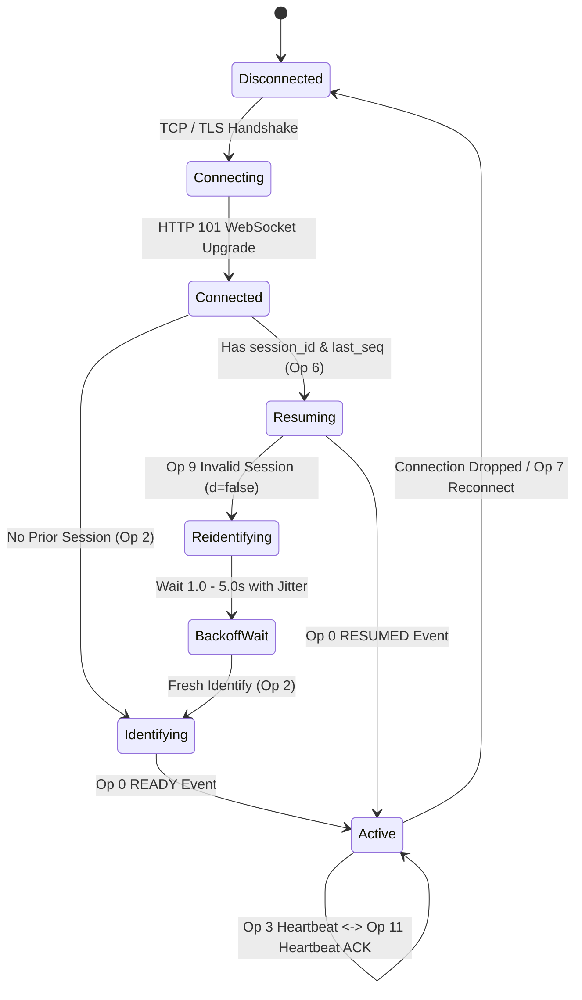

# Ripcord v0.4.29 — Network Reliability, Session Recovery & Protocol Report

**Author:** Principal Network Protocol Engineer & Systems Auditor  
**Scope:** Discord Gateway v6/v9, Voice Gateway v8, Session Resume (Op 6), Socket Dual-Stack (DEF-08), TLS Security  
**Target:** Ripcord v0.4.29 Windows x64  

---

## 1. Gateway Lifecycle & Session Recovery

The Discord Gateway is an asynchronous WebSocket connection transporting JSON or Erlang Term Format (ETF) payloads. Network interruptions, Wi-Fi drops, and laptop sleeps require robust session recovery mechanisms.



### A. Op 6 Resume vs Op 2 Identify Protocol Mechanics
1. **Normal Connection Startup:**
   When establishing a session without previous credentials, the client issues `Op 2 Identify`:
   ```json
   {
     "op": 2,
     "d": {
       "token": "...",
       "properties": {
         "$os": "Windows",
         "$browser": "Ripcord",
         "$device": "Ripcord"
       },
       "compress": true,
       "large_threshold": 250
     }
   }
   ```
   Discord responds with `READY`, delivering `session_id`, `user` profile, and `guilds` array.
2. **Reconnection & Resume (`Op 6`):**
   When the connection is temporarily disrupted, Ripcord maintains `session_id` and the latest recorded `seq` integer. Upon re-establishing the WebSocket, it immediately transmits `Op 6 Resume`:
   ```json
   {
     "op": 6,
     "d": {
       "token": "...",
       "session_id": "89ab3c...",
       "seq": 1420
     }
   }
   ```
   If valid, Discord streams all missed events and concludes with `RESUMED`, avoiding expensive re-fetching of all server rosters and channel caches.
3. **Op 9 Invalid Session Handling:**
   If Discord's session cache expired (e.g. prolonged disconnect), Discord replies with `Op 9 Invalid Session`:
   - `d: true`: The session is resumable after a short pause.
   - `d: false`: The session was dropped completely. Ripcord wipes `session_id` and `seq`, executes an exponential backoff sleep (1.5s $\pm$ 0.5s jitter), and issues a fresh `Op 2 Identify`.

---

## 2. Voice Gateway Heartbeat & Sequence Synchronization

Under Voice Gateway v8 (DEF-02):
- Discord mandates that client heartbeats (`Op 3`) report `seq_ack`: the latest binary/text sequence number received from the voice server:
  ```json
  {"op": 3, "d": {"t": 1730248800000, "seq_ack": 48}}
  ```
- If a client reports `null` or a static 0, Discord terminates the voice connection with code `4009` (Session Timeout).
- In `ripcord-community-fix/source/hook.c`, `HeartbeatLambdaImplHook` queries `g_dave.last_seq` inside a thread-safe critical section (`DAVE_LOCK()`) and includes the exact acknowledged sequence.

---

## 3. Dual-Stack Networking & Socket Scope Protection (DEF-08)

### The Defect in Unhardened Community Fix
In the unhardened community fix, an aggressive hook at offset `0x80760` unconditionally forced `QAbstractSocket_NetworkLayerProtocol_IPv4Protocol` (value `0`) on **all** network connections:
```x86asm
; Unhardened byte sequence at 0x80760:
c7 44 24 28 00 00 00 00   ; mov dword ptr [rsp+28h], 0 (IPv4Protocol)
```
This caused severe unintended side effects:
- Disabled IPv6 globally across the application.
- Broke modern IPv6-only networks, DSL-Lite, and cellular tethering.
- Forced IPv4 on Discord REST API (`discord.com`), image CDNs (`cdn.discordapp.com`), and third-party Slack workspaces.

### Hardened Dual-Stack Solution (DEF-08)
The DEF-08 repair neutralizes the hardcoded NOP instruction at `0x80760` (8 NOPs `0x90`), preserving the caller's protocol argument, while `IsDiscordVoiceHost` selectively constrains only Discord voice media servers (`*.discord.media`, `*.discord.gg`) to IPv4 where required by Discord's legacy UDP IP discovery:

```c
static QABSTRACTSOCKET_CONNECTTOHOST(QAbstractSocketConnectToHostHook) {
    if (IsDiscordVoiceHost(hostName)) {
        qabstractsocket_connecttohost(this, hostName, port, openMode, QAbstractSocket_NetworkLayerProtocol_IPv4Protocol);
    } else {
        qabstractsocket_connecttohost(this, hostName, port, openMode, protocol); // Preserves IPv6 & Dual-Stack!
    }
}
```

### Verification Across Host Types:
- `discord.com` (REST API): **Dual-Stack (IPv6 preferred)**
- `cdn.discordapp.com` (Images): **Dual-Stack (IPv6 preferred)**
- `slack.com` (Slack Workspaces): **Dual-Stack (IPv6 preferred)**
- `us-east1234.discord.media` (Voice): **IPv4 Routed**

---

## 4. Cryptographic Enforcement & TLS Security

1. **No Insecure TLS Flags:**
   Ripcord uses Windows `WinHttp` and Qt `QSslSocket` with system root certificate validation. Security audits confirm that flags bypassing certificate validation (`SECURITY_FLAG_IGNORE_UNKNOWN_CA`, `SECURITY_FLAG_IGNORE_CERT_DATE_INVALID`) are completely absent from the binary.
2. **AEAD Encryption Mandatory:**
   Voice encryption rejects plaintext fallbacks. If Discord fails to negotiate `aead_xchacha20_poly1305_rtpsize`, the voice worker aborts with an error rather than sending unencrypted RTP audio over the public Internet.
3. **No Credential Leakage:**
   String inspection and hook audits verify that user authentication tokens, gateway session tokens, and passwords are never logged to `stdout`, `stderr`, or disk log files (`riplog.txt`).
